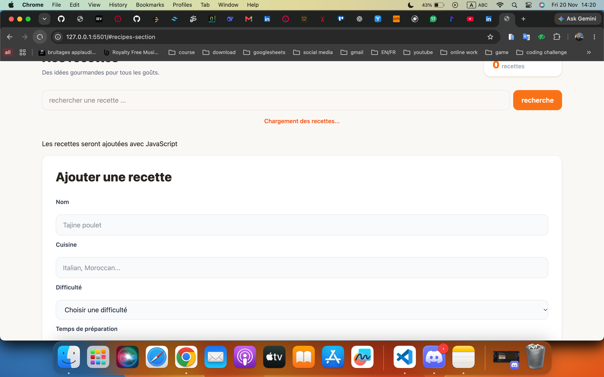
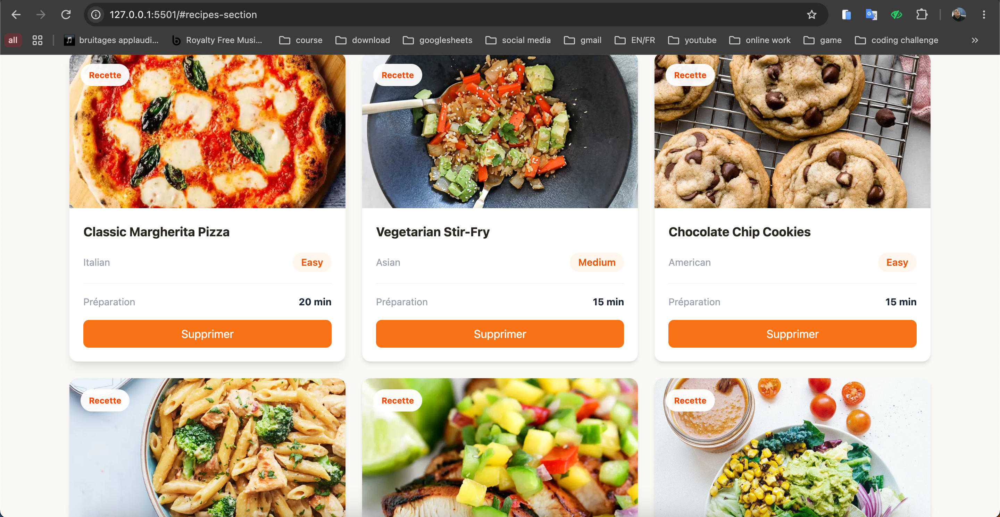
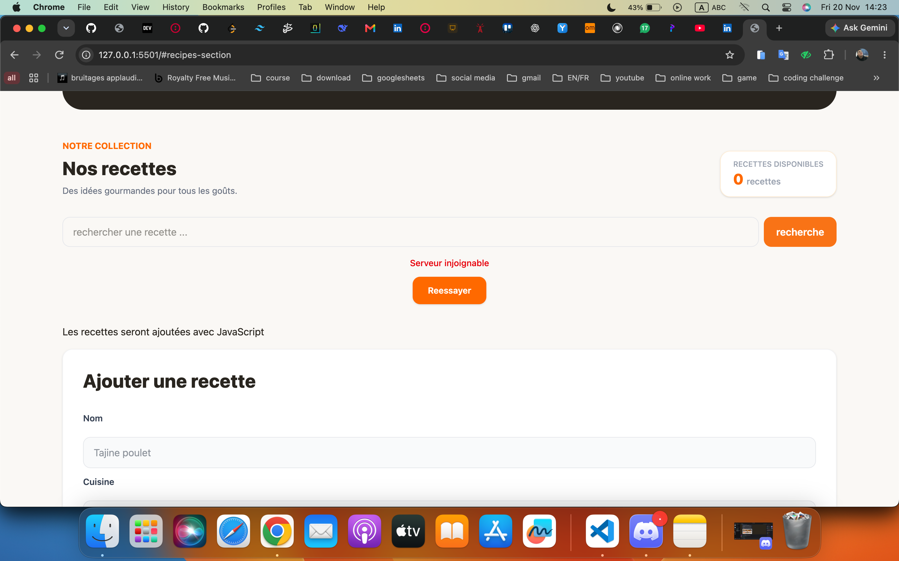
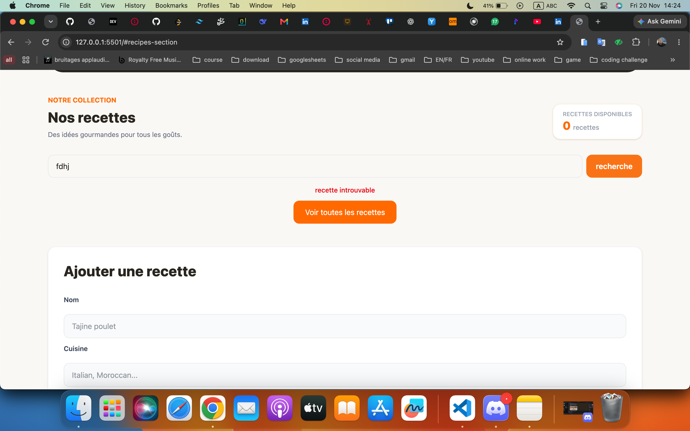

#  Carnet de recettes

##  Présentation du projet

Carnet de recettes est une application web qui permet aux utilisateurs de consulter, rechercher, ajouter et supprimer des recettes de cuisine.

L'application utilise l'API publique DummyJSON pour récupérer et gérer les recettes. Les requêtes HTTP sont réalisées avec Axios.

##  Objectifs

- Afficher une liste de recettes.
- Rechercher une recette par son nom.
- Ajouter une nouvelle recette.
- Supprimer une recette après confirmation.
- Valider les données du formulaire.
- Gérer les états de chargement et les erreurs API.

##  Technologies utilisées

- HTML5
- Tailwind CSS
- JavaScript (ES6+)
- Axios
- DummyJSON API
- Git et GitHub

##  Structure du projet

```text
carnet-recettes/
│
├── index.html
├── script.js
├── api.js
├── affichage.js
├── validation.js
├── ui.js
│
├── images/
│
└── README.md
```

### Rôle des fichiers

| Fichier | Responsabilité |
|---|---|
| `index.html` | Structure HTML de l'application |
| `script.js` | Gestion des événements et logique principale |
| `api.js` | Configuration Axios et requêtes HTTP |
| `affichage.js` | Création et affichage des cartes de recettes |
| `validation.js` | Validation des données du formulaire |
| `ui.js` | Gestion des messages d'erreur |

##  Documentation de l'API

**API utilisée :** [DummyJSON Recipes](https://dummyjson.com/docs/recipes)

**Base URL :** `https://dummyjson.com`

| Fonctionnalité | Méthode | URL | Données envoyées |
|---|---|---|---|
| Récupérer les recettes | GET | `/recipes?limit=15` | Aucune |
| Rechercher une recette | GET | `/recipes/search?q=...` | Paramètre `q` |
| Ajouter une recette | POST | `/recipes/add` | name, cuisine, difficulty, prepTimeMinutes |
| Supprimer une recette | DELETE | `/recipes/{id}` | ID dans l'URL |

### Réponses de l'API

- **GET :** retourne un objet contenant les recettes.
- **Recherche :** retourne les recettes correspondant au mot-clé.
- **POST :** retourne la recette créée.
- **DELETE :** retourne une confirmation de suppression.

##  Limites de l'API de démonstration

DummyJSON est une API de démonstration.

Les opérations POST et DELETE sont simulées : les modifications ne sont pas enregistrées de manière permanente sur le serveur.

Par conséquent, une recette ajoutée ou supprimée peut réapparaître après un nouveau chargement de l'application.

##  Scénarios de tests manuels

| Test | Action | Résultat attendu |
|---|---|---|
| Chargement | Ouvrir l'application | Affichage du chargement puis des recettes |
| Liste | Consulter les recettes | Les cartes sont affichées correctement |
| Recherche vide | Rechercher un mot-clé inexistant | Message indiquant aucun résultat |
| Ajout invalide | Envoyer un formulaire incorrect | Messages de validation |
| Ajout valide | Ajouter une recette correcte | Nouvelle carte affichée |
| Suppression | Confirmer la suppression | Carte supprimée de l'affichage |
| Erreur 404 | Simuler une réponse HTTP 404 | Message d'erreur approprié |
| Erreur 500 | Simuler une réponse HTTP 500 | Message d'erreur serveur |
| Hors-ligne | Désactiver la connexion Internet | Message « Serveur injoignable » |

##  Captures d'écran

Les captures d'écran de l'application seront ajoutées dans le dossier `images/screenshots/`.

### Chargement



### Liste des recettes



### Message d'erreur



### Aucun résultat



##  Installation et utilisation

1. Cloner le repository :

```bash
git clone https://github.com/mr-mohame/carnet-recettes.git
```

2. Ouvrir le dossier dans VS Code.

3. Ouvrir `index.html` avec Live Server.

## 🌍 Démo en ligne

[Accéder à l'application](https://mr-mohame.github.io/carnet-recettes/)

## 👨‍💻 Auteur

**Mohamed Lamssiah**

- GitHub : [@mr-mohame](https://github.com/mr-mohame)
- Projet : [Carnet de recettes](https://github.com/mr-mohame/carnet-recettes)

Projet réalisé dans le cadre d'un apprentissage du développement Front-End.